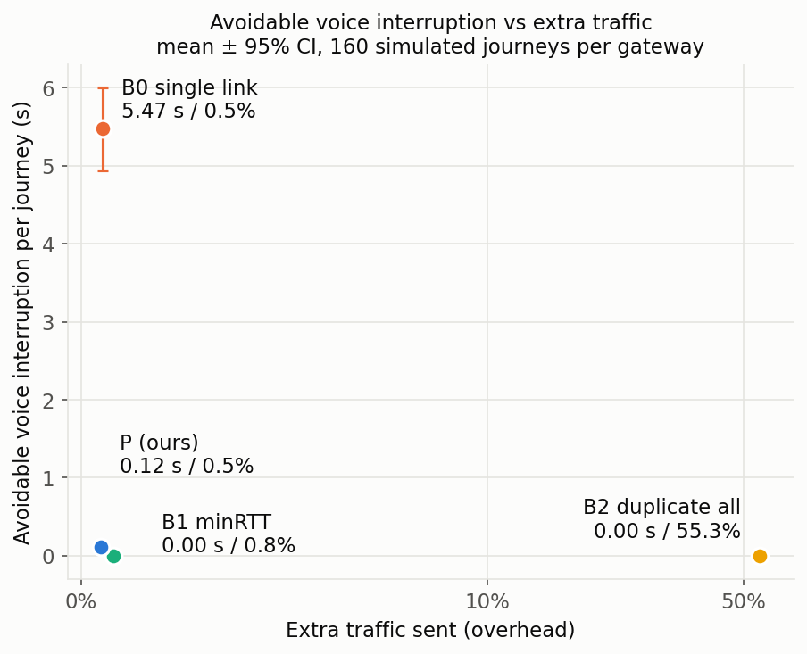
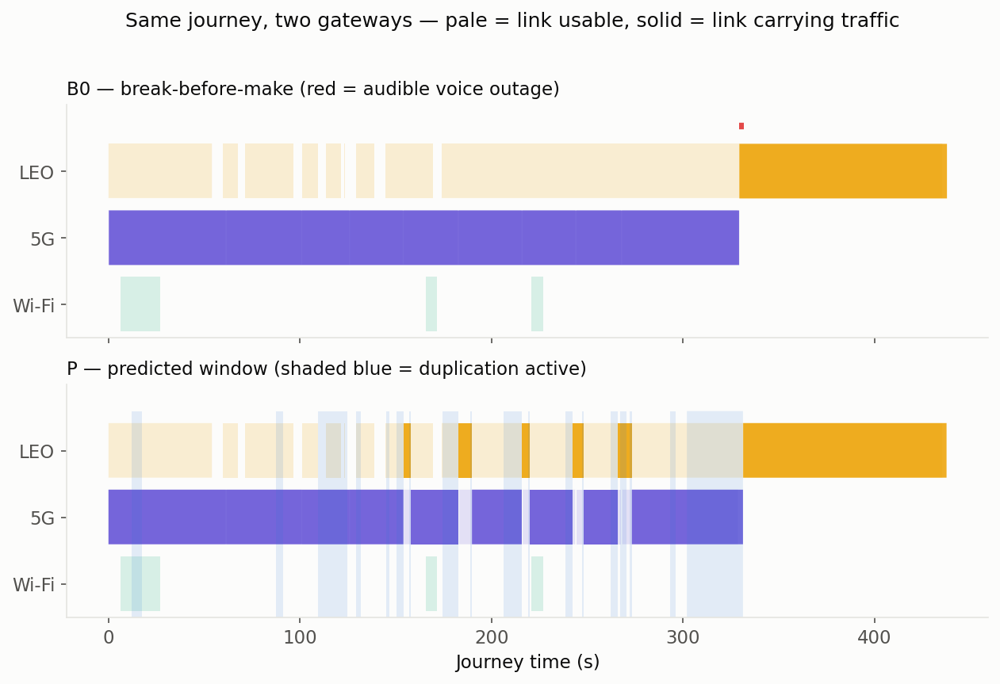
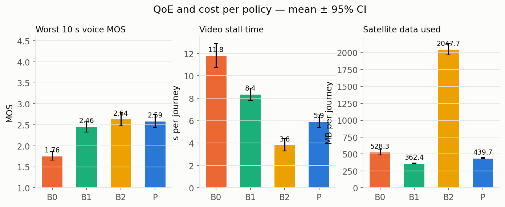
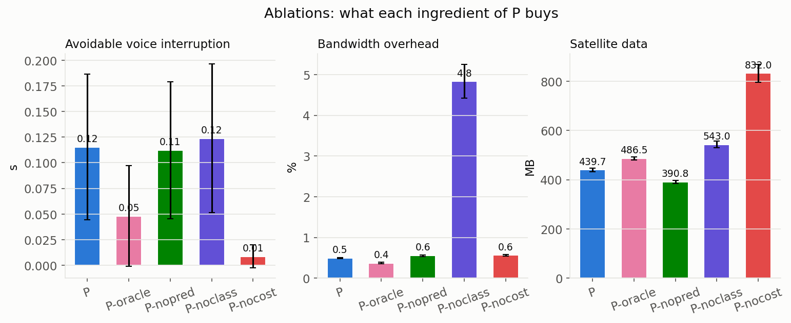
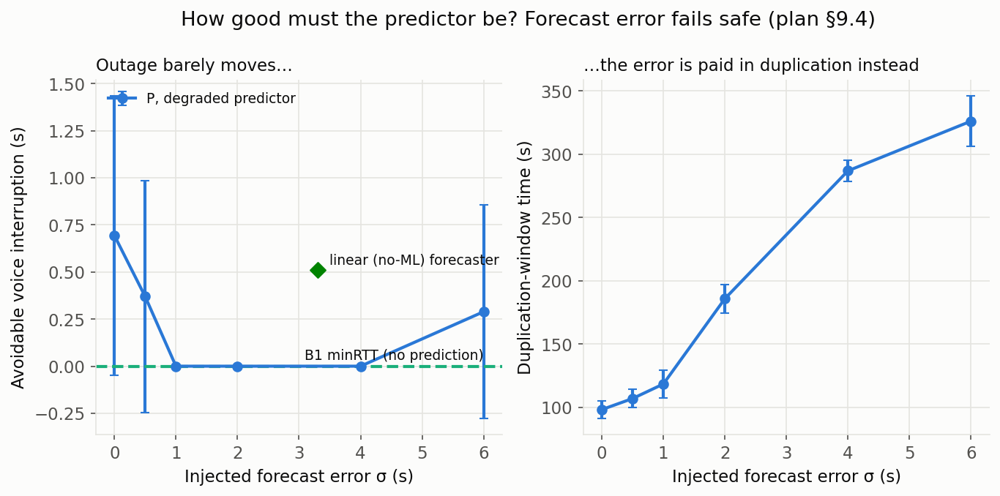
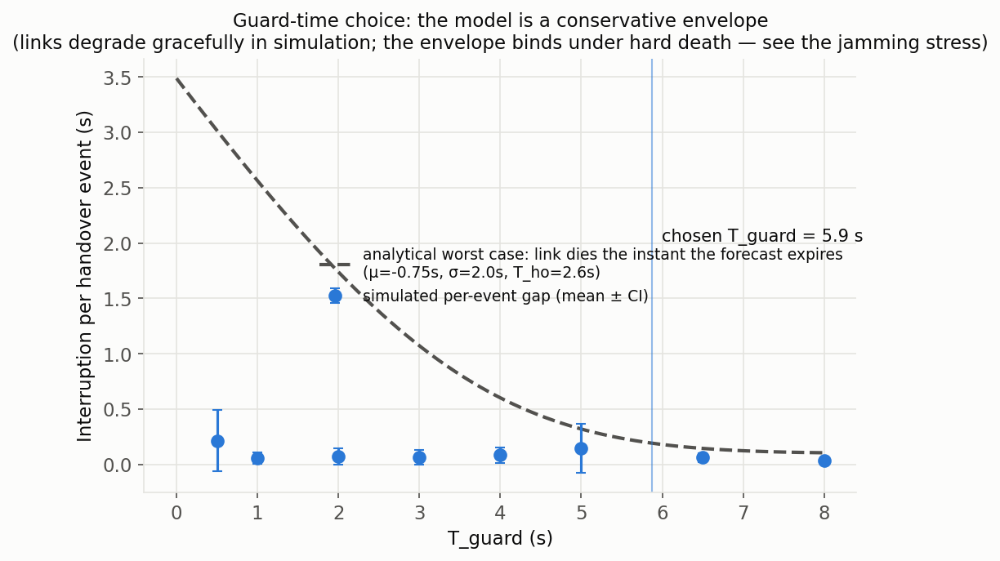

# Results: predictive, class-aware selective redundancy

Everything on this page is generated from logged runs by script
(`python scripts/run_all.py`). Nothing is drawn by hand.

**Interactive replay:** open [`index.html`](index.html) to play any of
8 journeys and compare our gateway with a baseline side by side.

## How to read these results

We compare four gateways on the same simulated journeys and the same traffic
(voice call, telemetry, live video, bulk sync):

| ID | Gateway | What it stands for |
|---|---|---|
| **B0** | Single link, switch after failure | What a normal device does today |
| **B1** | MPTCP-style minRTT, all links attached | The modern standard alternative |
| **B2** | Duplicate everything on the two best links | Continuity ceiling, and its bill |
| **P** | **Ours:** predict, protect by class, respect cost | The proposal |

**Setup:** 4 highway speeds (30, 60, 90, 120 km/h) × 2 directions × 20 seeds =
**160 journeys per gateway**, reported as mean ± 95% confidence interval.
The 5G link is calibrated from real 5G drive traces (Raca et al.); Wi-Fi and
LEO are modelled. Decisions use only what a real device could observe.

**"Avoidable" silence** leaves out time when no link at all was usable
(satellite obstructions at the remote site). No gateway can serve those
moments, and B2 confirms that floor. Raw totals are in the table below.

---

## 1. The headline: near-zero silence for almost no extra traffic

Each dot is one gateway. **Lower is less voice silence; further left is less
extra traffic. Bottom-left is best.**

- **B0** is cheap but drops the call: **5.47 s** of avoidable silence per journey.
- **B2** never drops the call but sends **55%** extra traffic and 2,048 MB of satellite data.
- **P (ours)** sits next to B1 in the bottom-left: **0.12 s** of silence for **0.5%** extra traffic and 440 MB of satellite data.

B1 matches us on silence. Our advantage over B1 is shown in section 3
(video stalls, ping-pong handovers).

## 2. The same journey, two gateways

120 km/h outbound, seed 1. Pale bands are links that were usable; solid bands
are the link carrying traffic. Red bars are audible voice outages and blue
shading is our predicted protection window.

B0 rides 5G until it collapses and then goes silent for about 2.5 s while it
reconnects. Ours opens short protection windows before each 5G dip, so the
call never drops. Animated version: [`demo.gif`](assets/demo.gif).

## 3. Quality of experience and cost

| Gateway | Worst 10 s voice MOS | Video stalled (s) | Satellite data (MB) |
|---|---|---|---|
| B0 | 1.76 | 11.8 | 528 |
| B1 | 2.46 | 8.4 | 362 |
| B2 | 2.64 | 3.8 | 2,048 |
| **P** | 2.59 | 5.9 | 440 |

Ours is close to B2's quality at about a fifth of its satellite data, and
better than B1 on voice and video. Worst-window MOS is low for every
multi-link gateway because of the unavoidable satellite obstructions noted
above. Ours also makes fewer ping-pong handovers than B1 (2.4 vs 6.1 per journey).

## 4. Why it works: each ingredient earns its place

We removed one ingredient at a time:

| Variant | What changes | Result vs full P |
|---|---|---|
| **P-noclass** | Duplicates every flow, not just voice and telemetry | Extra traffic rises from 0.49% to **4.83%** (about 10×) |
| **P-nocost** | Picks the partner by quality only | Satellite data rises from 440 to **832 MB** (about 1.9×) |
| **P-nopred** | Opens the window on a threshold instead of a forecast | Silence is statistically indistinguishable (0.11 vs 0.12 s): on this route the forecast's measurable benefit is small, and it is largest at high speed |
| **P-oracle** | Perfect predictor | 0.05 s of silence: the ceiling prediction could reach |

## 5. How good must the predictor be?

We deliberately degraded the forecast by up to 6 s. **Outage barely moves
(left); the error is paid in duplication time instead (right),** from about
100 s to 325 s per journey. A worse forecast costs money, not dropped calls.

## 6. Where the guard time comes from

The window opens when a link's forecast life drops below
`T_guard = T_ho − μ + z·σ = 5.9 s`: handover time plus the predictor's
held-out error margin, derived rather than tuned. The dashed curve is the
worst case (a link dying the instant its forecast expires), so simulation sits
below it because real links degrade gracefully. It is a conservative design
rule, not a fit.

## 7. Where it is weakest: jamming

An abrupt 5G kill gives no radio warning, so prediction cannot help:

| Gateway | Avoidable silence (s) | Satellite data (MB) |
|---|---|---|
| B0 | 9.58 ± 2.15 | 761 |
| B1 | 0.81 | 469 |
| B2 | 0.00 | 1,705 |
| P | 2.75 ± 0.92 | 539 |
| P-nocost (keeps LEO attached) | 0.27 ± 0.27 | 981 |

Keeping the satellite attached restores continuity at about twice the
satellite data. We report this honestly rather than hide it.

## 8. Simulation and emulation agree

The same journey was replayed in real Linux network namespaces (veth + netem,
our userspace tunnel and a de-duplicating proxy). The ordering matches the
simulator: B0 is clearly worst, B1 and B2 are best, only B2 pays a large
duplication overhead. Full table and caveats:
[`assets/crosscheck.md`](assets/crosscheck.md).

## Full results table

| Gateway | Avoidable silence (s) | Raw silence (s) | Worst MOS | Extra traffic (%) | Satellite (MB) | Video stalled (s) | Handovers | Ping-pongs |
|---|---|---|---|---|---|---|---|---|
| B0 | 5.47 ± 0.53 | 9.68 ± 1.05 | 1.76 ± 0.10 | 0.53 ± 0.01 | 528 | 11.80 ± 1.05 | 5.9 | 1.6 |
| B1 | 0.00 ± 0.00 | 3.61 ± 0.55 | 2.46 ± 0.13 | 0.79 ± 0.03 | 362 | 8.36 ± 0.56 | 12.4 | 6.1 |
| B2 | 0.00 ± 0.00 | 3.61 ± 0.55 | 2.64 ± 0.17 | 55.34 ± 0.43 | 2048 | 3.84 ± 0.55 | 16.5 | 7.0 |
| **P** | 0.12 ± 0.07 | 3.72 ± 0.56 | 2.59 ± 0.16 | 0.49 ± 0.02 | 440 | 5.93 ± 0.58 | 8.0 | 2.4 |

Raw data: [`assets/summary.csv`](assets/summary.csv),
[`assets/stress_summary.csv`](assets/stress_summary.csv).

## Known limitations

- Simulation and emulation only: no hardware or vehicle test yet.
- Wi-Fi and LEO links are modelled; only 5G is calibrated to real traces.
- The LEO attach time (2.5 s) is a placeholder pending a citable measurement.
- Uplink only, and wired is not a live link in the experiments.
- On some individual journeys (for example 90 km/h outbound, seed 1) P trails
  B1 and B2, because it keeps the satellite detached to save cost.
